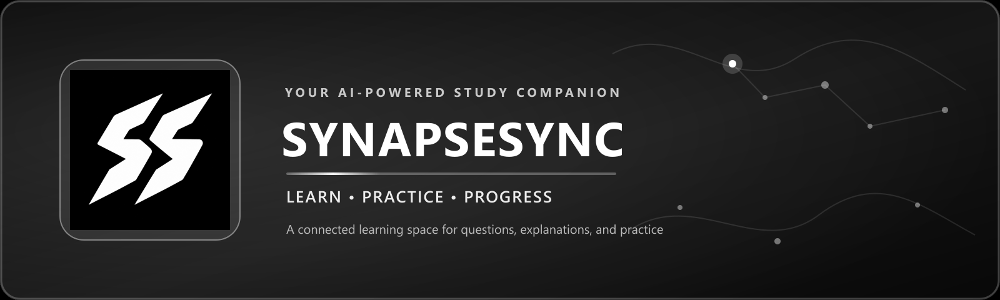
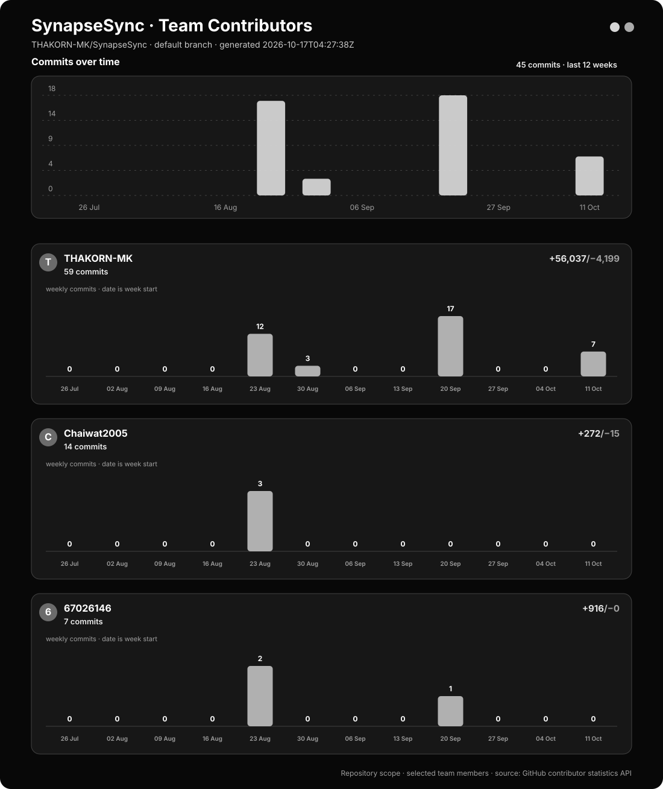

<div align="center">



</div>

---

<div align="center">

<a href="https://synapsesync-pyio.onrender.com"><kbd>🚀 เปิดเว็บ SynapseSync</kbd></a>

</div>

<div align="center">

### เปลี่ยนจุดที่ยังไม่เข้าใจ ให้เป็นการเรียนรู้ที่ต่อเนื่อง

เว็บแอปพลิเคชันที่เชื่อมคำถาม คำอธิบาย แบบฝึกหัด และความก้าวหน้าของผู้เรียนไว้ใน flow เดียว

<br>

<code>Learning Web App</code>
<code>Labs 01–07, 09 & 12B</code>
<code>Docs-first</code>
<code>Academic Project</code>

<br><br>

<a href="#-project-overview"><kbd>OVERVIEW</kbd></a>
<a href="#-core-learning-flow"><kbd>LEARNING FLOW</kbd></a>
<a href="#-personas"><kbd>PERSONAS</kbd></a>
<a href="#-documentation-hub"><kbd>DOCUMENTATION</kbd></a>
<a href="#-getting-started"><kbd>GET STARTED</kbd></a>
<a href="#-testing--ci"><kbd>TESTING &amp; CI</kbd></a>
<a href="#-team--brainlink-co"><kbd>TEAM</kbd></a>
<a href="#contribution-graph"><kbd>CONTRIBUTIONS</kbd></a>

</div>

---

## ✦ Project Overview

<div align="center">


</div>

<table>
<tr>
<td width="50%" valign="top">

### The Problem

เมื่อผู้เรียนติดขัดกับบทเรียน พวกเขามักต้องค้นหาคำอธิบายจากหลายแหล่ง ไม่กล้าถามซ้ำ และไม่รู้ว่าตัวเองเข้าใจจริงหรือเพียงแค่อ่านเฉลยแล้วรู้สึกว่าเข้าใจ

</td>
<td width="50%" valign="top">

### The Solution

SynapseSync ช่วยระบุจุดที่ยังไม่เข้าใจ อธิบายแนวคิดทีละขั้น สร้างโจทย์ที่เกี่ยวข้อง และบันทึกผลการฝึก เพื่อให้ผู้เรียนและผู้สอนใช้ข้อมูลนั้นวางแผนการเรียนรู้ต่อได้

</td>
</tr>
</table>

### Project at a Glance

| | |
|---|---|
| **Theme** | Tools for Modern Learners |
| **Primary User** | นักเรียนที่ต้องทบทวนและแก้จุดที่ไม่เข้าใจด้วยตนเอง |
| **Core Value** | ลดเวลาค้นหาคำอธิบายและเปลี่ยนความเข้าใจให้เป็นหลักฐานจากการฝึก |
| **Current Scope** | Lab 01–07, Lab 09 และ Lab 12B: requirements, prototype, architecture, first container, refactoring, testing/CI และ safety net |
| **Project Status** | Lab 01–02 ผ่านแล้ว; Lab 04–07 ผ่านการตรวจ; Lab 09 — PR #70 merge แล้ว พร้อมผล local verification 39 tests และ coverage 100% ใน scope ที่กำหนด; Lab 12B — PR #74 merge แล้ว, reviewer อนุมัติและ checks ผ่าน 6 รายการ; PR #73 ปิดโดยไม่ merge ใช้เก็บหลักฐาน `Merging is blocked`; Ruleset ของ `main` กำหนด PR, approval 1 คน และ checks `lint`/`test`; Post-quiz 12B ยังเป็นร่างให้ผู้จัดทำทบทวน |

> Lab 09 รวมเข้า `main` ผ่าน PR #70 แล้ว; Lab 12B รวมผ่าน PR #74 หลัง reviewer approve และ checks ผ่าน โดย PR #73 เก็บหลักฐานการบล็อกขณะ test fail แล้วปิดโดยไม่ merge; Post-quiz 12B ยังต้องให้ผู้จัดทำทบทวนก่อนส่ง

---

## ✦ Core Learning Flow

<div align="center">


</div>

<table>
<tr>
<td width="25%" align="center" valign="top">

### 01
**Ask**

ผู้เรียนส่งคำถามหรือเนื้อหาที่ไม่เข้าใจ

</td>
<td width="25%" align="center" valign="top">

### 02
**Clarify**

ระบบถามกลับเพื่อค้นหาจุดที่ติดขัดจริง

</td>
<td width="25%" align="center" valign="top">

### 03
**Practice**

ผู้เรียนรับคำอธิบายและฝึกโจทย์ที่เกี่ยวข้อง

</td>
<td width="25%" align="center" valign="top">

### 04
**Progress**

ระบบบันทึกผลและแสดงสิ่งที่ควรเรียนต่อ

</td>
</tr>
</table>

รายละเอียด narrative, edge cases และ Acceptance Criteria อยู่ใน [Main Scenario](./docs/requirements/main_scenario.md)

---

## ✦ Personas

| Persona | Role | Primary Goal | Usage Pattern |
|---|---|---|---|
| [ปันปัน](./docs/requirements/personas/student_learner.md) | Student Learner | เข้าใจบทเรียนและตรวจสอบความเข้าใจด้วยโจทย์ฝึก | หลายครั้งต่อสัปดาห์ |
| [ครูสมชาย](./docs/requirements/personas/teacher_mentor.md) | Teacher Mentor | ค้นหาหัวข้อและนักเรียนที่ต้องการความช่วยเหลือ | 2–3 ครั้งต่อสัปดาห์ |
| [พี่เอิร์ธ](./docs/requirements/personas/adult_learner.md) | Adult Learner | เรียนต่อเนื่องได้แม้ตารางงานไม่แน่นอน | 1–4 ครั้งต่อสัปดาห์ |
| [คุณแม่มล](./docs/requirements/personas/parent_guardian.md) | Supporting Persona | สนับสนุนผู้เรียนภายใต้ consent และ privacy | อ่านสรุปตามความจำเป็น |

> Lab 03 ใช้ Persona หลัก 3 คน ส่วนผู้ปกครองเป็น supporting research artifact จนกว่าทีมจะยืนยัน privacy และ consent flow

---

## ✦ Learning Ecosystem

<div align="center">


<sub>ระบบมีหน้าที่สนับสนุนการตัดสินใจของผู้เรียนและผู้สอน ไม่ใช่เฝ้าระวังหรือตัดสินผลการเรียนแทนมนุษย์</sub>

</div>

---

## ✦ Documentation Hub

<table>
<tr>
<td width="50%" valign="top">

### Product Foundation

- [Project Proposal](./docs/project-proposal.md) — Theme, value, scope, priorities and risks
- [Definition of Done](./docs/definition-of-done.md) — เกณฑ์ร่วมก่อนย้ายงานเป็น Done
- [AI Usage](./AI_USAGE.md) — เครื่องมือ AI ส่วนที่นำมาใช้ และวิธีตรวจสอบ
- [Lab 06 Evidence](./docs/evidence/lab06/README.md) — หลักฐาน build, health check และ Docker Hub
- [Lab 07 Refactoring Journal](./docs/refactoring-journal.md) — smell, refactor และ test-first evidence
- [Lab 09 CI Workflow](./.github/workflows/test.yml) — รันทดสอบอัตโนมัติเมื่อ push และ pull request
- [Lab 09 Saboteur Journal](./docs/saboteur-journal.md) — หลักฐาน mutation test และการ restore
- [Lab 12B Safety Net](./docs/safety-net.md) — test cases, coverage และวิธีรัน lint/test
- [Lab 12B CI Workflow](./.github/workflows/ci.yml) — lint และ test บน branch `feature/safety-net` และ PR เข้า `main`

</td>
<td width="50%" valign="top">

### Requirements

- [Persona Overview](./docs/requirements/personas.md)
- [Main Scenario and User Stories](./docs/requirements/main_scenario.md)
- [Software Requirements Specification](./docs/requirements/srs.md)
- [Measurable NFRs](./docs/requirements/nfr.md)

</td>
</tr>
<tr>
<td width="50%" valign="top">

### Prototype

- [Sprint 1 Entry Point](./prototypes/sprint1/index.html)
- [Prototype Workspace](./prototypes/sprint1/)
- [Prototype Guide and Test Evidence](./prototypes/sprint1/README.md)

Prototype เป็นงานสาธิตและยังไม่เชื่อมต่อ authentication หรือฐานข้อมูลจริง

</td>
<td width="50%" valign="top">

### Architecture

- [Architecture Overview](./docs/architecture/README.md)
- [Architecture Decision Records](./docs/architecture/adr/)
- [C4 Diagram Sources](./docs/architecture/diagrams/)
- [Team Reflections](./docs/reflections/) — บันทึก reflection ของสมาชิกทีม

Architecture Lab 05 ใช้ Modular Monolith เป็น implementation target โดย Lab 06 เริ่มพิสูจน์ deployable boundary ด้วย FastAPI first container

</td>
</tr>
</table>

---

## ✦ Getting Started

### เว็บ SynapseSync ที่ออนไลน์

เปิดใช้งานเว็บที่ deploy บน Render ได้ที่ **[https://synapsesync-pyio.onrender.com](https://synapsesync-pyio.onrender.com)**

### บัญชีสำหรับอาจารย์ทดสอบ

เพื่อความปลอดภัย ข้อมูลเข้าสู่ระบบของบัญชีทดสอบจะส่งให้อาจารย์ผ่านช่องทางส่วนตัว ไม่เผยแพร่อีเมลหรือรหัสผ่านไว้ใน repository สาธารณะ

### ทดลองเว็บทั้งระบบในเครื่อง (Docker Compose)

ต้องเปิด Docker Desktop ก่อน แล้วรันคำสั่งจากโฟลเดอร์หลักของ repository:

```powershell
docker compose -f compose.webapp.yml up --build
```

จากนั้นเปิดเว็บที่ <http://localhost:8080/>; API อยู่ที่ <http://localhost:8000/> และเอกสาร API อยู่ที่ <http://localhost:8000/docs> หากต้องการหยุด ให้กด `Ctrl+C` แล้วรัน `docker compose -f compose.webapp.yml down` ข้อมูลและไฟล์ที่สร้างในเครื่องเก็บไว้ใต้ `.local/` อย่าลบโฟลเดอร์นี้หากต้องการเก็บข้อมูลไว้

ฟีเจอร์ AI ต้องตั้ง `AI_API_KEY` ใน `services/api/.env` ก่อนใช้งาน และห้าม commit ไฟล์ `.env` ที่มี key จริง หากต้องการรันแยก API กับ Vite เพื่อพัฒนาแบบ hot reload ดูขั้นตอนใน [คู่มือ WebApp](./WebApp/README.md)

### Prerequisites

| Requirement | Used For |
|---|---|
| Git | Clone และทำงานร่วมกันใน repository |
| Modern Web Browser | เปิด Sprint 1 prototype |
| Python 3.12+ | รัน FastAPI service และ automated tests |
| Node.js 20.19+ | พัฒนาและทดสอบ WebApp |
| Docker Desktop/Engine | รัน WebApp และ API ในเครื่องด้วย Docker Compose |

### 1. Clone the Repository

```bash
git clone https://github.com/Software-Engineering-Concepts-2026/se-sec2-team-06.git
cd se-sec2-team-06
```

### 2. Open the Sprint 1 Prototype

เปิดไฟล์ต่อไปนี้ใน browser:

```text
prototypes/sprint1/index.html
```

สามารถใช้ static web server เช่น VS Code Live Server เพื่อให้ navigation ระหว่างหน้าทำงานใกล้เคียงสภาพแวดล้อมจริง

รายละเอียด flow, module และข้อจำกัดอยู่ใน [Prototype Guide](./prototypes/sprint1/README.md)

### 3. Run the FastAPI Service

```bash
python -m venv .venv
.venv\Scripts\activate
pip install -r services/api/requirements-dev.txt
cd services/api
uvicorn app.main:app --host 127.0.0.1 --port 8000
```

Health endpoint: `http://127.0.0.1:8000/health`

API documentation: `http://127.0.0.1:8000/docs`

### 4. Run Automated Checks

จาก repository root หลังติดตั้ง dependencies แล้ว (ตัวอย่างสำหรับ PowerShell):

```powershell
$env:PYTHONPATH = "services/api"
python -m pytest services/api/tests tests scripts/tests --cov=src --cov=services/api/app --cov-branch --cov-report=term-missing --cov-fail-under=90
```

ทดสอบ prototype แยกต่างหาก:

```bash
node --test prototypes/sprint1/tests/*.test.cjs
```

Browser tests ต้องใช้ Playwright และ Chrome ตามรายละเอียดใน [Prototype Guide](./prototypes/sprint1/README.md)

---

## ✦ Testing & CI

[](https://github.com/Software-Engineering-Concepts-2026/se-sec2-team-06/actions/workflows/test.yml)

ชุดทดสอบ Lab 09 ครอบคลุม unit และ boundary cases ของ contributor data, property-based tests, FizzBuzz kata และ API health checks ส่วน contributor graph มี tests สำหรับ API failure paths, การ normalize ข้อมูล และการ escape ข้อความก่อน render เป็น SVG

Lab 12B เพิ่ม Jest safety net 7 tests ให้ `buildQuestionViewModel()` ที่มี logic เรื่องคำตอบ, feedback, progress และ navigation โดยไม่แก้ runtime file ใน `prototypes/`. Jest ตรวจ coverage ของ module นี้แยกจาก Vitest; local verification ล่าสุดผ่าน 7 tests โดยมี statements/lines 96.29%, branches 89.47% และ functions 100%. PR #73 ถูกปิดโดยไม่ merge และใช้เก็บภาพ `Merging is blocked` ระหว่างทดลองให้ test fail ชั่วคราว; หลังคืน test ให้ผ่าน PR #74 ได้รับ reviewer approval, checks ผ่าน 6 รายการ และ merge เข้า `main` แล้ว. Ruleset ของ `main` กำหนดให้ใช้ PR, approval อย่างน้อย 1 คน และ required checks `lint`/`test`. รายละเอียดอยู่ใน [Lab 12B Safety Net](./docs/safety-net.md) และ [บันทึกหลักฐาน Lab 12B](./docs/evidence/lab12b/08-pr-merging-blocked-record.md); Post-quiz 12B ใน `reflect.md` ยังเป็นร่างที่ผู้จัดทำต้องทบทวน

สำหรับ Lab 09, PR #70 ถูกรวมเข้า `main` แล้ว. GitHub Actions ใช้ workflow [`.github/workflows/test.yml`](./.github/workflows/test.yml) ซึ่งทำงานเมื่อมี `push` หรือ `pull_request` และกำหนด coverage ขั้นต่ำ 90% สำหรับ source/API ที่ระบุใน workflow; ผล local verification ที่บันทึกไว้คือ **39 tests ผ่าน และ coverage 100% ใน `src/` กับ `services/api/app/`** ซึ่งเป็นส่วนที่ workflow วัด coverage

| Test suite | ครอบคลุม |
|---|---|
| [`tests/test_unit.py`](./tests/test_unit.py) | equivalence partitions, malformed input, allow-list, totals และลำดับผลลัพธ์ |
| [`tests/test_property.py`](./tests/test_property.py) | invariants ด้วย Hypothesis |
| [`tests/test_fizzbuzz.py`](./tests/test_fizzbuzz.py) | FizzBuzz behavior และ boundary ตัวอย่างตามโจทย์ |
| [`scripts/tests/test_generate_repo_contributors.py`](./scripts/tests/test_generate_repo_contributors.py) | contributor API responses, rendering, dates และ output safety |
| [`services/api/tests/test_health.py`](./services/api/tests/test_health.py) | health endpoint ของ FastAPI |
| [`WebApp/tests/lab12b/test_thakorn_quiz_view_model.test.cjs`](./WebApp/tests/lab12b/test_thakorn_quiz_view_model.test.cjs) | correct/incorrect answer, unanswered/empty boundary, malformed input และ module exports |

ดูหลักฐานการทดลอง saboteur ได้ที่ [Lab 09 Saboteur Journal](./docs/saboteur-journal.md)

Badge ด้านบนแสดงสถานะ workflow ของ Lab 09 บน `main`. สำหรับ Lab 12B, PR #74 เป็นหลักฐานการรวมหลัง checks ผ่าน; Ruleset `Protect main - Lab 12B` มีภาพหลักฐานแยกใน `docs/evidence/lab12b/`. ผล local verification ใช้ยืนยันเฉพาะการทดสอบในเครื่อง ไม่แทนสถานะ CI บน GitHub

### 5. Build the First Container

```bash
docker build -t synapsesync-api:v0.1.0 .
docker run --rm -p 8000:8000 synapsesync-api:v0.1.0
```

รายละเอียด image, security choices และ Container vs VM trade-off อยู่ใน [`docker/README.md`](./docker/README.md)

### 6. Pull the Verified Registry Image

```bash
docker pull thakornj/synapsesync-api:v0.1.0
```

ดู tag ล่าสุดได้ที่ [Docker Hub](https://hub.docker.com/r/thakornj/synapsesync-api/tags) และดูภาพหลักฐานใน [Lab 06 Evidence](./docs/evidence/lab06/README.md)

---

## ✦ Team — Brainlink Co.

<div align="center">

| Student ID | Member | GitHub |
|---|---|---|
| 67026023 | ฐากร ใจพล | [@THAKORN-MK](https://github.com/THAKORN-MK) |
| 67026012 | ไชยวัฒน์ แซ่ว้าง | [@Chaiwat2005](https://github.com/Chaiwat2005) |
| 67026146 | สุวิชาดา วงพีระ | [@67026146](https://github.com/67026146) |

</div>

---

<a id="contribution-graph"></a>

## Cᴏɴᴛʀɪʙᴜᴛɪᴏɴ Gʀᴀᴘʜ

กราฟนี้แสดง **commit activity ของ repository `Software-Engineering-Concepts-2026/se-sec2-team-06` เท่านั้น** โดยอ่านข้อมูลจาก GitHub repository contributor statistics บน default branch และคัดเฉพาะสมาชิกทีม 3 คนด้านล่าง ไม่ใช่กิจกรรมรวมจาก repository อื่นของสมาชิก

<div align="center">

<a href="https://github.com/Software-Engineering-Concepts-2026/se-sec2-team-06/graphs/contributors">
  
</a>

<br>

<sub>คลิกกราฟเพื่อดูข้อมูลล่าสุดจาก GitHub Insights · กราฟใน README จะอัปเดตโดย GitHub Actions</sub>
<br>
<sub>การ์ดของสมาชิกแสดงวันที่เริ่มต้นของแต่ละสัปดาห์และจำนวน commit ของช่วงนั้น ตามรูปแบบสถิติ Contributors ของ GitHub</sub>

</div>

| สมาชิกทีม | GitHub |
|---|---|
| ฐากร ใจพล | [@THAKORN-MK](https://github.com/THAKORN-MK) |
| ไชยวัฒน์ แซ่ว้าง | [@Chaiwat2005](https://github.com/Chaiwat2005) |
| สุวิชาดา วงพีระ | [@67026146](https://github.com/67026146) |

> สถิติของ GitHub อาจใช้เวลาประมวลผลหลังมีการเปลี่ยนแปลงประวัติ commit กราฟนี้เป็นหลักฐานกิจกรรมใน repository ไม่ใช่ตัววัดคุณภาพหรือปริมาณงานทั้งหมดของสมาชิก

---

## ✦ Team Workflow

<details>
<summary><strong>Meeting and Progress Tracking</strong></summary>

<br>

| การประชุม | ความถี่ | ระยะเวลา | วัตถุประสงค์ |
|---|---|---:|---|
| Sprint Planning | ต้นสัปดาห์ | 30–45 นาที | วางแผนเป้าหมายและแบ่งหน้าที่ |
| Progress Check-in | 2–3 ครั้งต่อสัปดาห์ผ่าน Discord | 10–15 นาที | อัปเดตความคืบหน้าและ blocker |
| Sprint Review / Demo | สิ้นสัปดาห์ | 20–30 นาที | สาธิตผลงานและตรวจความพร้อม |
| Retrospective | หลัง Sprint Review | 15–20 นาที | สรุปปัญหาและแนวทางปรับปรุง |

- การประชุมส่วนใหญ่ดำเนินการผ่าน **Discord**
- หากไม่มีประเด็นสำคัญ สามารถอัปเดตสถานะผ่านข้อความได้
- สมาชิกควรเข้าร่วมการประชุมหลักหรือแจ้งล่วงหน้าหากไม่สะดวก

</details>

<details>
<summary><strong>Team Communication</strong></summary>

<br>

ทีมใช้ **Discord** เป็นช่องทางหลักสำหรับเรื่องงาน และใช้ **Instagram** เป็นช่องทางสำรองสำหรับการติดต่อทั่วไป

- แยกการสนทนาตามหัวข้อเพื่อให้ค้นหาข้อมูลย้อนหลังได้
- แจ้งข้อจำกัดด้านเวลาและ blocker โดยเร็ว
- กรณีเร่งด่วน ให้ติดต่อผู้เกี่ยวข้องโดยตรงผ่าน Discord
- เป้าหมายคือให้สมาชิกเห็นข้อมูลชุดเดียวกันและตัดสินใจจากหลักฐาน

</details>

<details>
<summary><strong>Git and Review Workflow</strong></summary>

<br>

| Branch | Purpose | Rule |
|---|---|---|
| `main` | งานที่ผ่านการตรวจและพร้อมส่งมอบ | ห้าม push หรือ commit ตรง |
| `develop` | Integration branch สำหรับรวม feature | Merge หลังผ่านการตรวจ |
| `feature/<feature-name>` | งานเฉพาะ feature หรือ deliverable | สร้างจาก branch ฐานที่ทีมตกลง |

ใช้ Conventional Commits:

```text
feat: add login validation
fix: resolve empty question submission
docs: update requirements traceability
```

Pull Request ต้องมี reviewer อย่างน้อย 1 คน, checks ที่เกี่ยวข้องต้องผ่าน, ข้อคิดเห็นต้องได้รับการแก้ไข และผู้พัฒนาไม่ approve งานของตนเอง

</details>

<details>
<summary><strong>Team Decision Process</strong></summary>

<br>

1. ระบุทางเลือกและข้อจำกัดให้ชัดเจน
2. เปรียบเทียบข้อดี ข้อเสีย และผลกระทบ
3. เปิดให้สมาชิกแสดงความคิดเห็น
4. บันทึกข้อสรุปและเหตุผลเมื่อเป็นการตัดสินใจสำคัญ
5. ปรับ backlog และ artifacts ที่เกี่ยวข้องให้สอดคล้องกัน

การตัดสินใจด้านสถาปัตยกรรมควรถูกบันทึกเป็น ADR เพื่อให้ตรวจสอบย้อนหลังได้

</details>

---

## ✦ Project Status and Boundaries

| Area | Status | Notes |
|---|---|---|
| Lab 01 — First Pragmatic Commit | ✅ เสร็จแล้ว | Initial repository structure, commit convention และ team setup อยู่ในประวัติ Git |
| Lab 02 — Sprint Zero | ✅ เสร็จแล้ว | Project Board, Issues, labels, milestones และ Insights ตรวจครบแล้วบน GitHub |
| Lab 04 — Prototype | ✅ เสร็จแล้ว | Shared UI และ browser regression tests ผ่านใน environment ปัจจุบัน |
| Lab 05 — Architecture | ✅ เสร็จแล้ว | Mermaid C4 render ผ่าน และเลือก Modular Monolith ผ่าน ADR-0001 |
| Lab 06 — First Container | ✅ เสร็จแล้ว | Docker build/run, `HEALTHCHECK`, `/health` และ Docker Hub image `thakornj/synapsesync-api:v0.1.0` ผ่าน |
| Lab 07 — Refactoring Milestone 1 | ✅ เสร็จแล้ว | แยก `renderQuestion()` เป็น view model และ rendering helpers พร้อม test-first evidence |
| Lab 09 — Testing and CI | ✅ PR #70 merged | บันทึกผล local verification 39 tests ผ่านและ coverage 100% ใน `src/` กับ `services/api/app/`; workflow `test.yml` รันบน push/pull request และกำหนด coverage ขั้นต่ำ 90% |
| Lab 12B — Safety Net Sprint | ✅ PR #74 merged; 🟡 Post-quiz รอผู้จัดทำทบทวน | PR #73 ปิดโดยไม่ merge และเก็บภาพ `Merging is blocked`; PR #74 ผ่าน reviewer approval และ 6 checks ก่อน merge; Ruleset `main` บังคับ PR, approval 1 คน และ checks `lint`/`test`; local `lint`, 3 Vitest tests และ 7 Jest tests ผ่าน |

### Product Boundaries

- AI ไม่ตัดสินคะแนนหรือผลการเรียนอย่างเป็นทางการ
- คำอธิบายจาก AI อาจผิดได้และต้องเปิดทางให้ตรวจสอบหรือรายงานปัญหา
- ระบบไม่เปิดเผยข้อมูลผู้เรียนแก่บุคคลอื่นโดยไม่มี consent และ authorization
- ทีมจะไม่เพิ่ม feature นอก MoSCoW scope โดยไม่มีการตัดสินใจร่วมกัน

---

<div align="center">

### Built for learning, reviewed with evidence.

โครงการนี้จัดทำเพื่อการเรียนรู้ในรายวิชา **Software Engineering Concepts**<br>
พัฒนาโดยทีม **Brainlink Co.**

</div>

---

## License

Copyright (c) 2026 Brainlink Co.

Permission is hereby granted, free of charge, to any person obtaining a copy
of this software and associated documentation files (the "Software"), to deal
in the Software without restriction, including without limitation the rights
to use, copy, modify, merge, publish, distribute, sublicense, and/or sell
copies of the Software, and to permit persons to whom the Software is
furnished to do so, subject to the following conditions:

The above copyright notice and this permission notice shall be included in all
copies or substantial portions of the Software.

THE SOFTWARE IS PROVIDED "AS IS", WITHOUT WARRANTY OF ANY KIND, EXPRESS OR
IMPLIED, INCLUDING BUT NOT LIMITED TO THE WARRANTIES OF MERCHANTABILITY,
FITNESS FOR A PARTICULAR PURPOSE AND NONINFRINGEMENT. IN NO EVENT SHALL THE
AUTHORS OR COPYRIGHT HOLDERS BE LIABLE FOR ANY CLAIM, DAMAGES OR OTHER
LIABILITY, WHETHER IN AN ACTION OF CONTRACT, TORT OR OTHERWISE, ARISING FROM,
OUT OF OR IN CONNECTION WITH THE SOFTWARE OR THE USE OR OTHER DEALINGS IN THE
SOFTWARE.
