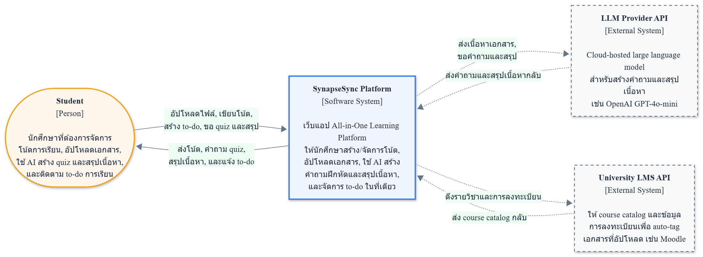
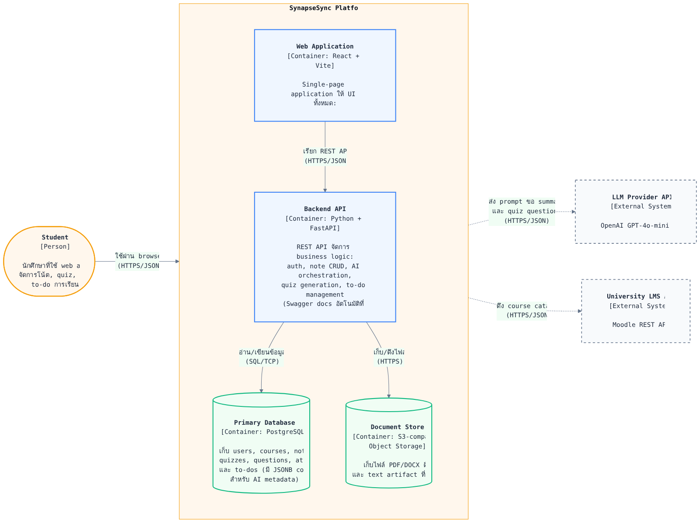

# สถาปัตยกรรมโปรเจกต์ (Project Architecture)

โฟลเดอร์นี้เก็บแผนภาพสถาปัตยกรรมและบันทึกการตัดสินใจ (Architecture Decision Records) ของโปรเจกต์ **SynapseSync** — เว็บแอปพลิเคชัน All-in-One Learning Platform สำหรับนักศึกษา ที่รวมฟีเจอร์การจัดการโน้ตการเรียน การอัปโหลดเอกสาร PDF/DOCX ระบบ AI Quiz Generator ที่สร้างคำถามจากเนื้อหา และระบบ To-do List สำหรับติดตามงานการเรียน ไว้ในที่เดียว

## ภาพรวมสถาปัตยกรรม

SynapseSync ออกแบบเป็นเว็บแอปพลิเคชันแบบ 2-tier ตามมาตรฐาน:

- **React SPA** (deploy บน Vercel) จัดการ UI ทั้งหมดที่ผู้ใช้สัมผัส: หน้าแก้ไขโน้ต, อัปโหลดไฟล์, จัดการ To-do, และหน้าทำ quiz
- **Python/FastAPI REST API** (deploy บน Render หรือ Railway) จัดการ business logic, authentication, การ orchestrate AI request, และ persistence
- **PostgreSQL** (managed โดย Supabase หรือ Neon) เก็บข้อมูลที่มีโครงสร้าง: users, courses, notes, to-dos, quizzes, questions, และ attempts
- **S3-compatible object store** (Cloudflare R2 หรือ AWS S3) เก็บไฟล์ PDF/DOCX ดิบและ text artifact ที่ extract แล้ว
- **LLM Provider API** ภายนอก (OpenAI GPT-4o-mini) ถูกเรียกจาก backend เพื่อสร้างคำถามและสรุปเนื้อหา
- **University LMS API** ภายนอก (Moodle) ถูกเรียกเพื่อ auto-tag เอกสารที่อัปโหลดด้วย course metadata

สำหรับเหตุผลเต็มของการเลือก stack นี้ ดูที่ [ADR-001: การเลือก Core Technology Stack](./adr/0001-tech-stack-selection.md)

---

## C4 Model: System Context (Level 1)

แผนภาพ System Context แสดง SynapseSync เป็นกล่องเดียวและความสัมพันธ์กับบุคคลและระบบภายนอกที่ระบบพึ่งพา เป็นมุมมองระดับสูงสุดของสถาปัตยกรรม เหมาะสำหรับผู้ฟังทุกประเภท รวมถึงผู้ที่ไม่ใช่นักเทคนิค



**ข้อสรุปสำคัญ:**

- **Student** เป็น actor มนุษย์เพียงคนเดียวที่ติดต่อโดยตรงกับระบบ
- SynapseSync พึ่งพาระบบภายนอก 2 ระบบ ได้แก่ **LLM Provider API** (สำหรับฟีเจอร์ AI สร้างคำถามและสรุปเนื้อหา) และ **University LMS API** (สำหรับดึง course catalog และข้อมูลการลงทะเบียนมา auto-tag เอกสาร) — ทั้งสองระบบนี้เป็นระบบอิสระที่มีเจ้าของแยกต่างหากจากทีม (OpenAI/Anthropic และมหาวิทยาลัยตามลำดับ)
- **Cloud Object Storage** ไม่แสดงเป็น External System ใน Level นี้ เพราะเป็น Infrastructure ที่ทีมเป็นผู้ deploy/config เอง (ดูรายละเอียดใน C2 ในฐานะ Container "Document Store")
- การเชื่อมต่อกับระบบภายนอกทั้งหมดเริ่มจาก SynapseSync — ไม่มีระบบภายนอกใด push ข้อมูลเข้ามาในแพลตฟอร์มของเรา

### ซอร์สโค้ด

Mermaid source ของแผนภาพนี้อยู่ที่ [`diagrams/c4-level-1-context.mmd`](./diagrams/c4-level-1-context.mmd) เพื่อให้สามารถ regenerate หรือ update ได้ในฐานะ "Documentation as Code"

---

## C4 Model: Container (Level 2)

แผนภาพ Container ซูมเข้าไปใน boundary ของ SynapseSync และแสดงหน่วยที่ deploy ได้แบบหลัก (containers) พร้อมวิธีการสื่อสารระหว่างกัน เหมาะสำหรับ developer และ architect ที่ต้องการเข้าใจ runtime topology



**ข้อสรุปสำคัญ:**

- System boundary (กล่องสีเทา) ประกอบด้วย **4 containers**: React Web Application, FastAPI Backend API, PostgreSQL Primary Database, และ S3-compatible Document Store
- **Student** ติดต่อโดยตรงเฉพาะกับ Web Application ผ่าน HTTPS เท่านั้น — ไม่ได้เรียก backend หรือ database โดยตรง
- Backend API เป็นจุด orchestrate เดียว: ให้บริการ SPA, query database, อ่าน/เขียนไฟล์ใน object storage, และเรียก API ภายนอก (LLM, LMS)
- ระบบภายนอก (LLM Provider, LMS) ปรากฏเป็นกล่องที่มีเส้นประนอก system boundary ตามธรรมเนียม C4 มาตรฐาน

### ซอร์สโค้ด

Mermaid source ของแผนภาพนี้อยู่ที่ [`diagrams/c4-level-2-container.mmd`](./diagrams/c4-level-2-container.mmd)

---

## บันทึกการตัดสินใจทางสถาปัตยกรรม (Architecture Decision Records — ADRs)

ADR เป็นเอกสารสั้นที่ไม่เปลี่ยนแปลง ใช้บันทึก "เหตุผล" ที่ตัดสินใจเลือกทางเทคนิคที่สำคัญ แต่ละ ADR มีเลขกำกับเรียงตามลำดับและเก็บใน [`./adr/`](./adr/)

| ADR | ชื่อเรื่อง | สถานะ |
|---|---|---|
| [ADR-001](./adr/0001-tech-stack-selection.md) | การเลือก Core Technology Stack ของโปรเจกต์ SynapseSync | Accepted |

### รูปแบบ ADR ที่ใช้ในโปรเจกต์นี้

- ฟิลด์ **สถานะ** ติดตาม lifecycle: `Proposed` → `Accepted` → `Deprecated` / `Superseded`
- **บริบท** อธิบายแรงกดดันในขณะตัดสินใจ (ทักษะทีม, timeline, ข้อจำกัด)
- **การตัดสินใจ** ระบุสิ่งที่เลือกและเหตุผลอย่างชัดเจน
- **ผลกระทบ** ระบุทั้งผลบวกและลบ — เราหลีกเลี่ยง ADR ที่มองแค่ด้านเดียว
- **ทางเลือกอื่นที่พิจารณา** บันทึกตัวเลือกที่ปฏิเสธ เพื่อให้ maintainer ในอนาคตเข้าใจ trade space
- เมื่อ ADR ถูกทำเครื่องหมาย `Accepted` แล้ว จะ **ไม่ถูกแก้ไข** — หากการตัดสินใจเปลี่ยน ต้องเขียน ADR ใหม่ที่ supersede ตัวเดิม

---

## หมายเหตุด้านความปลอดภัยและธรรมาภิบาล

ตามแนวทาง *Grounded Security & Governance Alert — 2026*:

- แผนภาพและ ADR ในโฟลเดอร์นี้ใช้ **ชื่อนามธรรม** เท่านั้น (เช่น "LLM Provider API", "Primary Database") ไม่มี hostname, IP address, ชื่อ bucket จริง หรือ account identifier ใดๆ ถูก commit เข้า repository
- Secret จริง (API keys, database URLs, OAuth client secrets) ถูกจัดการผ่าน **GitHub Secrets** และ inject เข้า runtime environment ตอน deploy ไม่มีใน source file, environment file ที่ commit, หรือแผนภาพใดๆ
- Pull Request ที่แก้ไขโฟลเดอร์นี้จะถูก review หาการ leak secret ด้วยความเข้มข้นเดียวกับ code review — แผนภาพที่มีรายละเอียด infrastructure จริงจะถูก reject ก่อน merge

---

## โครงสร้างโฟลเดอร์

```
docs/architecture/
├── README.md                                  ← ไฟล์นี้
├── diagrams/
│   ├── c4-level-1-context.mmd                 ← Mermaid source (C1)
│   ├── c4-level-1-context.png                 ← ภาพที่ render แล้ว (C1)
│   ├── c4-level-2-container.mmd               ← Mermaid source (C2)
│   └── c4-level-2-container.png               ← ภาพที่ render แล้ว (C2)
└── adr/
    └── 0001-tech-stack-selection.md           ← ADR-001
```

## วิธี Regenerate แผนภาพ

หากแก้ไขไฟล์ `.mmd` และต้องการ regenerate PNG สามารถใช้ Mermaid CLI:

```bash
# ติดตั้งครั้งเดียว (ถ้ายังไม่ได้ติดตั้ง)
npm install -g @mermaid-js/mermaid-cli

# Regenerate Level 1
mmdc -i docs/architecture/diagrams/c4-level-1-context.mmd \
     -o docs/architecture/diagrams/c4-level-1-context.png \
     -w 1600 -b white

# Regenerate Level 2
mmdc -i docs/architecture/diagrams/c4-level-2-container.mmd \
     -o docs/architecture/diagrams/c4-level-2-container.png \
     -w 1600 -b white
```

หรือ paste เนื้อหา `.mmd` ลงใน [mermaid.live](https://mermaid.live) เพื่อดู preview และ download ทันที
