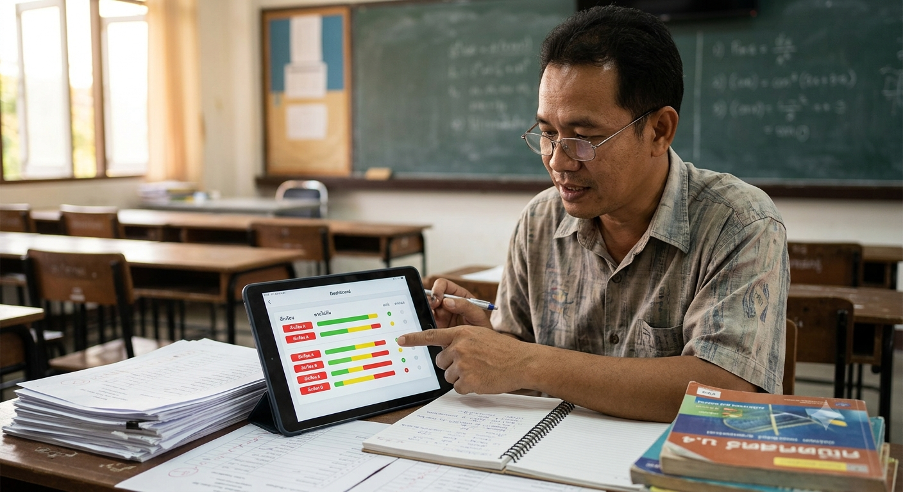

# Persona — ครูสมชาย

> “ผมอยากรู้ว่านักเรียนคนไหนกำลังตามไม่ทันจริง ๆ ก่อนที่จะสายเกินไป ไม่ใช่มารู้ตอนสอบตก”

## Profile at a Glance

| หัวข้อ | รายละเอียด |
|---|---|
| **Archetype** | Teacher Mentor |
| **Age / Experience** | อายุ 42 ปี มีประสบการณ์สอนคณิตศาสตร์ 15 ปี |
| **Workload** | ดูแลนักเรียนมากกว่า 120 คนในหลายห้อง |
| **Primary Device** | คอมพิวเตอร์สำหรับงานสอนและ Google Classroom |
| **Expected Frequency** | สัปดาห์ละ 2–3 ครั้งและก่อนวางแผนสอนเสริม |

## Five Persona Elements

### 1. Personalization

ครูสมชายเป็นครูคณิตศาสตร์ระดับมัธยมที่มีประสบการณ์สูง เขาใส่ใจนักเรียนแต่ต้องรับผิดชอบหลายห้องพร้อมกัน จึงไม่สามารถติดตามพัฒนาการของนักเรียนทุกคนได้ละเอียดในแต่ละวัน

### 2. Job / Role

สอนเนื้อหาตามหลักสูตร ตรวจงาน ประเมินความเข้าใจ และจัดการสอนเสริม เขาต้องตัดสินใจว่าจะใช้เวลาที่จำกัดช่วยนักเรียนคนใดและหัวข้อใดก่อน

### 3. Education

มีความเชี่ยวชาญด้านคณิตศาสตร์และการสอน คุ้นเคยกับระบบจัดการชั้นเรียนทั่วไป แต่ไม่ได้ต้องการเรียนรู้เครื่องมือวิเคราะห์ที่ซับซ้อนหรือคำศัพท์ทางเทคนิคจำนวนมาก

### 4. Relevance to SynapseSync

ครูสมชายใช้ข้อมูลสรุปจากผลการฝึกเพื่อค้นหาหัวข้อที่นักเรียนติดขัดและดูว่ามีหลักฐานการพัฒนาหรือไม่ ระบบต้องช่วยลดเวลาอ่านข้อมูล ไม่ใช่เพิ่มงานบันทึกข้อมูลให้ครู

### 5. Frequency of Use

คาดว่าจะเปิด dashboard สัปดาห์ละ 2–3 ครั้ง ก่อนสอนเสริม และก่อนช่วงประเมินผล โดยแต่ละครั้งต้องเข้าใจสถานการณ์ได้ภายในไม่กี่นาที

## Goals and Motivations

- ค้นหานักเรียนที่ต้องการความช่วยเหลือก่อนเกิดผลกระทบต่อการสอบ
- ใช้เวลาสอนเสริมกับปัญหาที่มีหลักฐานรองรับ
- เห็นแนวโน้มรายหัวข้อโดยไม่ตรวจข้อมูลทีละคน
- ติดตามว่าคำแนะนำหรือการฝึกเพิ่มเติมช่วยนักเรียนได้หรือไม่

## Frustrations and Pain Points

- ไม่มีเวลาตรวจและติดตามนักเรียนมากกว่า 120 คนอย่างละเอียด
- มักพบปัญหาเมื่อคะแนนกลางภาคหรือปลายภาคออกแล้ว
- Dashboard ที่มีข้อมูลมากเกินไปทำให้ค้นหาประเด็นสำคัญช้า
- ไม่ต้องการระบบที่ต้องกรอกข้อมูลเดิมซ้ำหลายครั้ง

## Behaviors and Technology Habits

- ใช้คอมพิวเตอร์และ Google Classroom ในงานประจำ
- อ่านข้อมูลแบบตารางและสรุปสั้นได้สะดวกกว่ากราฟที่ซับซ้อน
- ต้องการเห็นช่วงเวลาของข้อมูลเพื่อไม่ตัดสินใจจากข้อมูลเก่า
- ยอมรับเครื่องมือใหม่เมื่อมีขั้นตอนชัดเจนและไม่เพิ่มภาระงาน

## Product Needs

- Dashboard ที่สรุปหัวข้อ นักเรียน และสถานะการฝึกอย่างกระชับ
- Filter ตามห้องเรียน หัวข้อ และช่วงเวลา
- Timestamp ที่บอกว่าข้อมูลอัปเดตล่าสุดเมื่อใด
- Role-based access เพื่อให้เห็นเฉพาะนักเรียนที่อยู่ในความรับผิดชอบ
- ข้อมูลที่ใช้ประกอบการช่วยเหลือ ไม่ใช่คำตัดสินอัตโนมัติจาก AI

## Related Artifacts

- [Persona overview](../personas.md)
- [Main scenario](../main_scenario.md)
- [Software Requirements Specification](../srs.md)
