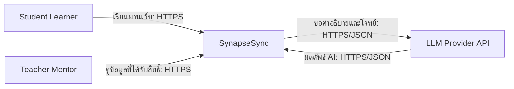
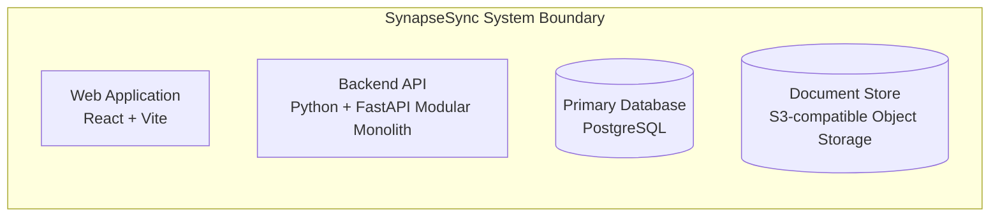

# Lab 05 Architectural Artifacts Implementation Plan

> **For agentic workers:** REQUIRED SUB-SKILL: Use superpowers:subagent-driven-development (recommended) or superpowers:executing-plans to implement this plan task-by-task. Steps use checkbox (`- [ ]`) syntax for tracking.

**Goal:** สร้างและปรับ Architectural Artifacts ของ SynapseSync ให้ครบตาม Lab 05 ด้วยสถาปัตยกรรม Modular Monolith ที่ทีมอนุมัติ

**Architecture:** React + Vite Web Application เรียก FastAPI Backend API ผ่าน HTTPS/JSON โดย Backend เป็น Modular Monolith ที่ deploy หน่วยเดียว ใช้ PostgreSQL และ S3-compatible Object Storage และเรียก LLM Provider ผ่าน adapter ภายนอก

**Tech Stack:** Markdown, Mermaid flowchart, React + Vite, Python + FastAPI, PostgreSQL, S3-compatible Object Storage, HTTPS/JSON, Docker

**Spec:** `docs/superpowers/specs/2026-08-24-lab05-architecture-design.md`

## Global Constraints

- ห้ามสร้างหรือสลับ branch
- ห้าม commit, push, merge หรือเปิด Pull Request
- ห้ามแก้ path ที่มีชื่อ `Chaiwat` หรือ `shuwichada` แบบไม่สนตัวพิมพ์เล็ก-ใหญ่
- ห้ามแก้ Prototype และ implementation ใน Lab 05 documentation task นี้
- University LMS, External Notification Service, Parent data sharing และ Microservices ไม่อยู่ใน MVP diagram
- Mermaid ต้องอยู่ใน Markdown และ render ได้โดยไม่มี syntax error
- C4 Container ต้องมี 4 containers พร้อม technology label และทุก edge ต้องมี protocol/purpose

---

### Task 1: C4 Context and Container Deliverables

**Files:**
- Create: `docs/architecture/c4-context.md`
- Create: `docs/architecture/c4-container.md`

**Interfaces:**
- Consumes: Personas ใน `docs/requirements/personas.md`, scope ใน `docs/project-proposal.md`, FR/NFR ใน `docs/requirements/srs.md` และ `docs/requirements/nfr.md`
- Produces: Canonical C4 Level 1 และ Level 2 links สำหรับ Architecture README และ Tech Stack

- [x] **Step 1: Create the Context document**

ใช้ Mermaid `flowchart LR` ที่มี `Student`, `Teacher`, `SynapseSync` และ `LLMProvider` เท่านั้น พร้อม relation labels:



เพิ่ม sections: Purpose, Scope, Elements, Key Relationships, Requirement Traceability และ Boundaries

- [x] **Step 2: Create the Container document**

ใช้ Mermaid `flowchart LR` ที่มี system boundary และ 4 containers:



เพิ่ม actors, LLM Provider และ edges ที่ระบุ HTTPS/JSON, SQL/TCP และ S3 API/HTTPS พร้อมตาราง Container Responsibilities และ data flow

- [x] **Step 3: Check structural requirements**

Run:

```powershell
rg -n '^```mermaid|Student Learner|Teacher Mentor|LLM Provider|React \+ Vite|FastAPI|PostgreSQL|S3-compatible|HTTPS/JSON|SQL/TCP' docs/architecture/c4-context.md docs/architecture/c4-container.md
```

Expected: พบ Mermaid block, actors, external system, technology labels และ protocol ครบ

---

### Task 2: Technology Stack and ADR-0001

**Files:**
- Create: `docs/architecture/tech_stack.md`
- Modify: `docs/architecture/adr/0001-tech-stack-selection.md`

**Interfaces:**
- Consumes: Container names จาก Task 1 และ NFR IDs จาก `docs/requirements/nfr.md`
- Produces: Stack choices/rationales และ decision record ที่ Architecture README อ้างอิง

- [x] **Step 1: Create the technology stack table**

สร้างตารางคอลัมน์ `Layer | Choice | Contextual Rationale | Alternative | Trade-off` จำนวน 9 layers:

1. Frontend — React + Vite
2. UI Styling — CSS Modules + shared design tokens
3. API Contract — REST over HTTPS/JSON + OpenAPI
4. Backend — Python 3.11+ + FastAPI Modular Monolith
5. Database — PostgreSQL 15+
6. Document Storage — S3-compatible Object Storage
7. AI Integration — Provider adapter over HTTPS/JSON
8. Deployment — Docker; Vercel for Web and Render for API
9. Testing/Quality — Vitest/Playwright, pytest และ GitHub Actions

ทุก rationale ต้องเชื่อมกับ timeline, team size, Must-have flow หรือ NFR โดยไม่ใช้เหตุผลเพียงว่า “ทีมถนัด”

- [x] **Step 2: Rewrite ADR-0001 as one architecture decision**

คงชื่อไฟล์เดิมเพื่อรักษา link แต่เปลี่ยนหัวข้อเป็น `ADR-0001: Adopt a Modular Monolith for the MVP` และต้องมี sections:

```markdown
## Status
Accepted

## Context
ทีมมีเวลาหนึ่งภาคการศึกษาและต้องส่งมอบ Must-have flow ที่เชื่อม authentication, AI assistance, practice และ progress โดยรักษา performance, security และ maintainability ตาม NFR ที่ประกาศไว้ การแยก service จะเพิ่ม deployment และ observability overhead ก่อนมีข้อมูลด้าน scale รองรับ

## Decision
ใช้ FastAPI Backend ที่ deploy เป็นหน่วยเดียวและแบ่ง capability modules เป็น Authentication, Learning Assistant, Practice/Quiz, Progress และ Document Context โดยให้แต่ละ module สื่อสารภายใน process และใช้ PostgreSQL ชุดเดียว

## Consequences
### Positive
### Negative

## Alternatives Considered
### Microservices
### Full-stack Server-rendered Monolith
```

ระบุ extraction trigger สำหรับอนาคต: independent scaling/deployment need ที่วัดได้, ownership boundary ชัด และ operational readiness

- [x] **Step 3: Verify rubric coverage**

Run:

```powershell
rg -n '^\| .* \|.*\|.*\|.*\|.*\|$|^## (Status|Context|Decision|Consequences|Alternatives Considered)' docs/architecture/tech_stack.md docs/architecture/adr/0001-tech-stack-selection.md
```

Expected: Tech Stack มี 9 layer rows และ ADR มี Michael Nygard 5 sections ครบ

---

### Task 3: ADR Numbering and Architecture Index

**Files:**
- Create: `docs/architecture/adr/0002-rest-api-communication.md`
- Delete after migration: `docs/architecture/adr/001-use-restful-api-internal-commu.md`
- Modify: `docs/architecture/README.md`

**Interfaces:**
- Consumes: Canonical C4 and Tech Stack paths จาก Tasks 1–2
- Produces: Entry document ที่เชื่อม deliverables ทั้งหมดโดยไม่มี ADR number collision

- [x] **Step 1: Migrate REST ADR to ADR-0002**

ใช้ 5 sections เดียวกับ ADR-0001 เปลี่ยน Context จาก “internal microservices” เป็นการสื่อสารระหว่าง Web Application กับ Backend API และบันทึก REST/OpenAPI เป็น decision

- [x] **Step 2: Remove the duplicate-number source**

หลังยืนยันว่าเนื้อหาถูกย้ายครบ ให้ลบ `001-use-restful-api-internal-commu.md` ผ่าน `apply_patch` เพื่อลด ADR หมายเลขซ้ำ

- [x] **Step 3: Rewrite the Architecture README as the canonical index**

README ต้องมี:

- Architecture summary และ scope status
- Links ไป `c4-context.md`, `c4-container.md`, `tech_stack.md`, ADR-0001 และ ADR-0002
- Modular Monolith module boundaries
- Diagram source policy: Mermaid Markdown เป็น Lab deliverable หลัก; draw.io/PNG/`.mmd` เดิมเป็น supporting historical artifacts
- Explicit future options สำหรับ LMS/Notification โดยไม่แสดงเป็น current architecture
- Security and governance notes

- [x] **Step 4: Check references and contradictions**

Run:

```powershell
rg -n 'c4-context.md|c4-container.md|tech_stack.md|0001-tech-stack-selection.md|0002-rest-api-communication.md|Modular Monolith' docs/architecture/README.md
```

Expected: canonical links และ architecture decision ปรากฏครบ

---

### Task 4: Reflection and AI Disclosure

**Files:**
- Create: `reflect.md`
- Modify: `AI_USAGE.md`

**Interfaces:**
- Consumes: Decisions and trade-offs from Tasks 1–3
- Produces: Required Lab 05 reflection and disclosure artifacts

- [x] **Step 1: Create the three-part reflection**

สร้าง `reflect.md` ด้วย 3 sections:

1. ADR Reflection — ทำไมบริบททำให้ Modular Monolith เหมาะกว่า Microservices
2. C4 Reflection — Level 1 และ Level 2 ช่วยให้ stakeholder ต่างกลุ่มเข้าใจอะไร
3. Tech Stack Reflection — rationale ที่ดีต้องเชื่อมกับ constraints/NFR และ alternative อย่างไร

เพิ่ม note ว่าเป็น team reflection draft ที่ต้องผ่านการอ่านยืนยันโดยผู้ส่งก่อนใช้เป็น Post-quiz evidence

- [x] **Step 2: Append Lab 05 to AI_USAGE.md**

เพิ่ม sections ที่โจทย์กำหนด:

- Tools Used
- Prompt Purposes โดยบันทึกอย่างน้อย 2 prompt purposes
- AI-Assisted Content Accepted After Review
- Human Decisions and Rejected Suggestions
- Verification Performed

ระบุชัดว่า AI ช่วย syntax, consistency audit และ challenge trade-offs แต่ทีมเลือก Modular Monolith และ Tech Stack

- [x] **Step 3: Scan for unsupported completion claims**

Run:

```powershell
rg -n 'production-ready|ใช้งานจริงแล้ว|deploy แล้ว|ทดสอบผู้ใช้แล้ว|LMS.*current|Microservices architecture' reflect.md AI_USAGE.md docs/architecture
```

Expected: ไม่พบ claims ที่ขัดกับสถานะ Prototype/MVP

---

### Task 5: Lab 05 Verification

**Files:**
- Verify only: all files from Tasks 1–4

**Interfaces:**
- Consumes: Completed Lab 05 artifacts
- Produces: Fresh verification evidence for the final report

- [x] **Step 1: Verify required files**

Run `Test-Path` for:

```text
docs/architecture/c4-context.md
docs/architecture/c4-container.md
docs/architecture/tech_stack.md
docs/architecture/adr/0001-tech-stack-selection.md
AI_USAGE.md
reflect.md
```

Expected: all `True`

- [x] **Step 2: Extract and render Mermaid blocks**

ใช้ Mermaid CLI/parser ที่มีใน environment แยก code block จาก Markdown ทั้งสองไฟล์และ render เป็น temporary SVG นอก repository

Expected: ทั้งสอง diagram render สำเร็จโดยไม่มี syntax error

- [x] **Step 3: Validate local Markdown links**

ตรวจ links ใน `docs/architecture/*.md`, ADR ทั้งสอง, `reflect.md` และ `AI_USAGE.md` ด้วย path resolution

Expected: ไม่มี missing local target

- [x] **Step 4: Check formatting and protected paths**

Run:

```powershell
git diff --check
git status --short -- prototypes/sprint1/Chaiwat prototypes/sprint1/shuwichada docs/reflections/Chaiwat.md docs/reflections/Shuwichada.md
```

Expected: ไม่มี whitespace error และ protected-path status ไม่มี output

- [x] **Step 5: Report without Git mutation**

สรุป files changed, requirement traceability, verification evidence และข้อจำกัดเรื่อง GitHub preview/screenshots โดยยืนยันว่าไม่มี commit หรือ push
